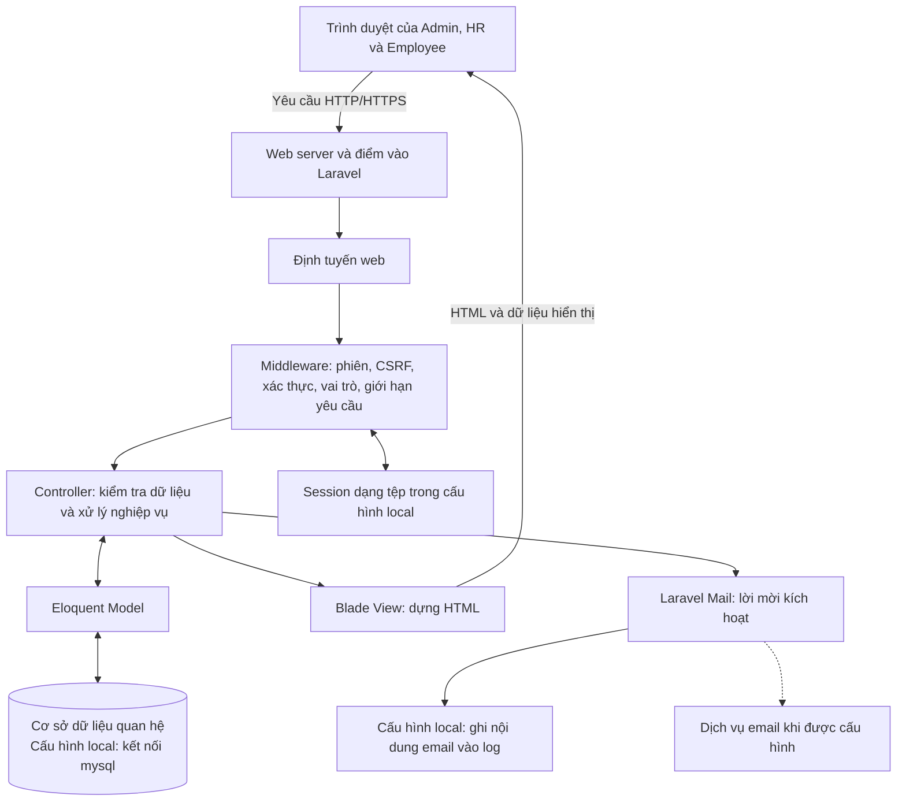
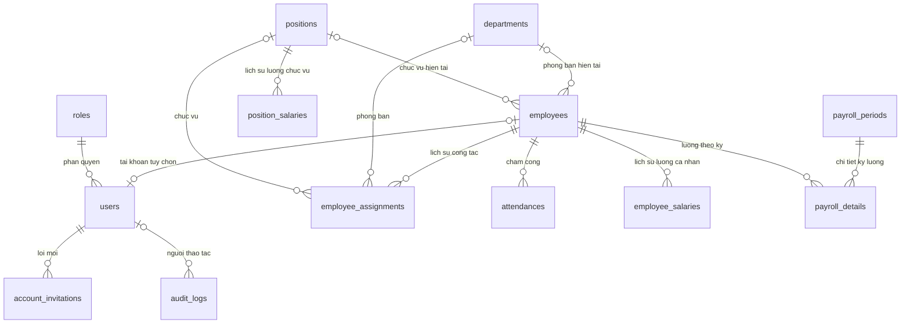

# BÁO CÁO KIẾN TRÚC TỔNG THỂ HỆ THỐNG QUẢN LÝ NHÂN SỰ

**Dự án:** Webquanlynhansu  
**Ngày lập:** 13/10/2026  
**Cơ sở báo cáo:** Mã nguồn, cấu hình và các migration trong dự án tại thời điểm khảo sát. Các mô tả về chức năng đã triển khai được xác định bằng việc đọc mã nguồn; báo cáo không thay thế kết quả kiểm thử vận hành.

## 1. Tổng quan hệ thống

Hệ thống quản lý nhân sự được xây dựng dưới dạng ứng dụng web, phục vụ việc lưu trữ hồ sơ nhân viên, quản lý thông tin tổ chức, cấp tài khoản và theo dõi các thay đổi liên quan đến nhân sự. Người dùng truy cập bằng trình duyệt; máy chủ tiếp nhận yêu cầu, xử lý nghiệp vụ, truy xuất cơ sở dữ liệu và trả về giao diện HTML.

Phạm vi dữ liệu của dự án còn bao gồm chấm công, lịch sử lương, kỳ lương và chi tiết bảng lương. Trong phiên bản được khảo sát, các phần này đã có thiết kế bảng dữ liệu và lớp mô hình, nhưng các controller tương ứng chủ yếu mới là khung phương thức. Vì vậy, cần phân biệt phạm vi thiết kế tổng thể với những chức năng đã có xử lý nghiệp vụ.

Hệ thống có ba nhóm người dùng:

| Nhóm người dùng | Vai trò trong thiết kế | Quyền truy cập thể hiện trong mã nguồn |
| --- | --- | --- |
| Quản trị viên — Admin | Quản trị hệ thống và dữ liệu nhân sự | Truy cập khu vực quản trị, quản lý hồ sơ và tạo tài khoản nhân viên |
| Nhân sự — HR | Thực hiện nghiệp vụ quản lý nhân sự | Cùng được truy cập các tuyến quản trị hiện có như Admin |
| Nhân viên — Employee | Sử dụng khu vực dành cho nhân viên | Truy cập khu vực `/user`; trang hồ sơ cá nhân hiện mới là nội dung giữ chỗ |

Các vai trò tương ứng với `role_id` là 1, 2 và 3. Mã nguồn hiện chưa tách quyền chi tiết giữa Admin và HR đối với từng thao tác quản trị.

## 2. Mô hình kiến trúc tổng thể

### 2.1. Kiểu kiến trúc

Ứng dụng sử dụng **kiến trúc nguyên khối (monolithic)** trên nền tảng Laravel và tổ chức mã nguồn theo **mô hình MVC — Model, View, Controller**. Các chức năng cùng nằm trong một ứng dụng, sử dụng chung cơ chế định tuyến, xác thực, cấu hình và kết nối dữ liệu.

Về trách nhiệm, kiến trúc được chia thành ba lớp logic:

1. **Lớp trình bày:** Các trang Blade, HTML, CSS và JavaScript hiển thị thông tin, biểu mẫu và thông báo cho người dùng.
2. **Lớp xử lý ứng dụng:** Router, middleware và controller tiếp nhận yêu cầu, xác thực, phân quyền, kiểm tra dữ liệu và thực hiện nghiệp vụ.
3. **Lớp truy cập và lưu trữ dữ liệu:** Eloquent Model biểu diễn thực thể và quan hệ; cơ sở dữ liệu quan hệ lưu trữ dữ liệu tập trung.

Ba lớp logic này không đồng nghĩa với ba máy chủ độc lập. Ở cấu trúc hiện tại, phần giao diện phía máy chủ và phần nghiệp vụ cùng được triển khai trong ứng dụng Laravel. Chưa có lớp Service hoặc Repository riêng; phần lớn nghiệp vụ đã triển khai nằm trực tiếp trong controller.

### 2.2. Sơ đồ kiến trúc



Nét đứt thể hiện kết nối email cần cấu hình thêm để gửi thư thực tế. Thư mời hiện được gọi gửi đồng bộ trong luồng xử lý tạo tài khoản.

### 2.3. Công nghệ sử dụng

| Thành phần | Công nghệ hoặc cấu hình xác định từ dự án | Vai trò |
| --- | --- | --- |
| Ngôn ngữ phía máy chủ | PHP, ràng buộc phiên bản `^8.3` | Thực thi ứng dụng |
| Framework | Laravel, ràng buộc phiên bản `^13.17` | Định tuyến, MVC, xác thực, ORM, validation và mail |
| Kết xuất giao diện | Blade | Tạo HTML phía máy chủ |
| Giao diện quản trị | Bootstrap 5.3.3, Bootstrap Icons 1.11.3, CSS và JavaScript tùy chỉnh | Bố cục, biểu mẫu, điều hướng và tương tác |
| Biểu đồ | Chart.js 4.4.4 | Hiển thị biểu đồ trên dashboard |
| Truy cập dữ liệu | Eloquent ORM | Ánh xạ đối tượng và quan hệ dữ liệu |
| Kết nối cơ sở dữ liệu local | Driver `mysql` | Lưu trữ dữ liệu ứng dụng; chưa xác minh phiên bản máy chủ cơ sở dữ liệu |
| Xác thực | Laravel Auth với guard `web`, dùng session | Quản lý đăng nhập và phiên người dùng |
| Công cụ tài nguyên giao diện | Vite `^8.0.0`, Tailwind CSS `^4.0.0` được khai báo | Hạ tầng biên dịch tài nguyên có trong dự án |
| Quản lý thư viện | Composer và npm | Quản lý các phụ thuộc PHP và công cụ giao diện |

Các phiên bản có dấu `^` là ràng buộc trong tệp khai báo phụ thuộc, không phải kết quả kiểm tra phiên bản đang chạy. Layout quản trị hiện nạp Bootstrap và Chart.js qua CDN; việc có Tailwind và Vite trong cấu hình chưa thể hiện rằng giao diện quản trị hiện tại được xây dựng bằng Tailwind.

## 3. Tổ chức các thành phần ứng dụng

### 3.1. Lớp trình bày

Giao diện được tổ chức thành khu vực xác thực, khu vực quản trị và khu vực nhân viên. Khu vực quản trị sử dụng layout chung cùng các thành phần header, sidebar và footer. Các trang quản lý nhân viên có giao diện danh sách, thêm mới, chỉnh sửa và xem chi tiết.

Blade nhận dữ liệu từ controller để hiển thị hồ sơ, danh mục phòng ban, chức vụ và trạng thái tài khoản. Các biểu mẫu gửi yêu cầu về ứng dụng bằng HTTP; sau khi xử lý, controller thường chuyển hướng về trang phù hợp kèm thông báo kết quả. JavaScript hỗ trợ thao tác giao diện như đóng mở thanh điều hướng và dựng biểu đồ.

Dashboard quản trị đã có bố cục và biểu đồ, nhưng nhiều số liệu đang được khai báo trực tiếp trong view. Khu vực nhân viên đã có tuyến truy cập riêng, còn trang hồ sơ mới chứa nội dung giữ chỗ. Do đó, chưa xem hai phần này là chức năng thống kê và tự phục vụ nhân viên hoàn chỉnh.

### 3.2. Định tuyến và middleware

Các tuyến nghiệp vụ web được khai báo trong [tệp định tuyến](C:/xampp/htdocs/MNMNC/Webquanlynhansu/routes/web.php). Tuyến gốc chuyển hướng về trang đăng nhập. Các khu vực chính gồm:

| Nhóm tuyến | Mục đích | Kiểm soát truy cập |
| --- | --- | --- |
| `/login` | Hiển thị và xử lý đăng nhập | Middleware `guest` |
| `/logout` | Đăng xuất bằng yêu cầu POST | Middleware `auth` |
| `/account/activate/{token}` | Xem và gửi biểu mẫu kích hoạt | Kiểm tra token trong controller và giới hạn số yêu cầu |
| `/admin` | Dashboard, CRUD nhân viên và tạo tài khoản | `auth` kết hợp `role:1,2` |
| `/user` | Khu vực dành cho nhân viên | `auth` kết hợp `role:3` |

Middleware vai trò kiểm tra `role_id` của người dùng và trả về lỗi 403 nếu người dùng không có quyền vào khu vực yêu cầu. Dự án hiện tập trung vào các tuyến web; chưa có lớp API nghiệp vụ riêng được đăng ký trong cấu hình khởi động đang khảo sát.

### 3.3. Controller và nghiệp vụ

Các controller có xử lý nghiệp vụ chính gồm:

| Thành phần | Trách nhiệm |
| --- | --- |
| `AuthController` | Kiểm tra đăng nhập, cập nhật thời điểm đăng nhập, chuyển hướng theo vai trò và đăng xuất |
| `EmployeeController` | Tìm kiếm, lọc, phân trang, thêm, xem, sửa, xóa mềm hồ sơ; cập nhật lịch sử phân công và ghi nhật ký |
| `UserController` | Tạo tài khoản Employee ở trạng thái chờ kích hoạt, tạo lời mời và gọi gửi email |
| `AccountInvitationController` | Kiểm tra lời mời, tiếp nhận mật khẩu, kích hoạt tài khoản và ghi nhận lời mời đã dùng |

Controller sử dụng validation của Laravel để kiểm tra đầu vào và Eloquent để làm việc với dữ liệu. Các thao tác liên quan nhiều bản ghi sử dụng transaction. Một số luồng cập nhật sử dụng khóa bản ghi bằng `lockForUpdate()` nhằm kiểm soát yêu cầu đồng thời.

### 3.4. Phạm vi các phân hệ

| Phân hệ | Phạm vi thiết kế | Mức độ triển khai qua khảo sát mã nguồn |
| --- | --- | --- |
| Xác thực và phân quyền | Đăng nhập, đăng xuất, phân khu theo vai trò | Đã có xử lý |
| Hồ sơ nhân viên | CRUD, tìm kiếm, lọc và phân trang | Đã có xử lý và giao diện; danh sách phân trang 15 bản ghi |
| Tài khoản và lời mời | Tạo tài khoản, gửi liên kết, tự đặt mật khẩu | Đã có xử lý; việc gửi email thực tế phụ thuộc mailer |
| Phòng ban, chức vụ | Danh mục tổ chức và phân loại nhân viên | Đã có model, migration, seeder và được dùng trong hồ sơ; CRUD độc lập chưa hoàn thiện |
| Lịch sử phân công | Ghi nhận thay đổi phòng ban, chức vụ theo thời gian | Đã ghi dữ liệu qua thao tác tạo và sửa nhân viên; controller riêng còn là khung |
| Chấm công | Ngày làm việc, giờ vào/ra, số giờ và trạng thái | Đã có cấu trúc dữ liệu; chưa có nghiệp vụ hoàn chỉnh |
| Tiền lương | Lương theo chức vụ, lương cá nhân, kỳ lương và chi tiết lương | Đã có cấu trúc dữ liệu; chưa triển khai quy trình tính, duyệt và thanh toán |
| Nhật ký thao tác | Lưu người thực hiện, đối tượng và giá trị thay đổi | Đã ghi ở các luồng nhân viên, tạo tài khoản và kích hoạt; chưa có giao diện tra cứu riêng |
| Dashboard và hồ sơ cá nhân | Tổng hợp thông tin và tự phục vụ | Dashboard dùng dữ liệu mẫu; hồ sơ cá nhân mới là nội dung giữ chỗ |

## 4. Kiến trúc dữ liệu

### 4.1. Các nhóm dữ liệu

Các migration định nghĩa 13 bảng thuộc phạm vi nghiệp vụ. Bảng `employees` là trung tâm hồ sơ nhân sự, liên kết đến tổ chức, tài khoản, lịch sử công tác, chấm công và tiền lương.

| Nhóm | Bảng | Nội dung chính |
| --- | --- | --- |
| Tổ chức | `departments`, `positions` | Phòng ban, chức vụ, mô tả và trạng thái hoạt động |
| Nhân sự | `employees` | Mã nhân viên, họ tên, liên hệ, giấy tờ định danh, ngày vào làm và trạng thái |
| Tài khoản | `users`, `roles`, `account_invitations` | Thông tin đăng nhập, vai trò, trạng thái và lời mời kích hoạt |
| Quá trình công tác | `employee_assignments` | Phòng ban, chức vụ và khoảng thời gian hiệu lực của từng phân công |
| Chấm công | `attendances` | Ngày công, giờ vào, giờ ra, số giờ làm và trạng thái |
| Tiền lương | `position_salaries`, `employee_salaries`, `payroll_periods`, `payroll_details` | Mức lương, hệ số, thời gian hiệu lực, kỳ lương và kết quả lương dự kiến lưu trữ |
| Truy vết | `audit_logs` | Người thao tác, hành động, đối tượng, dữ liệu trước/sau, IP và thời điểm |

Ngoài ra, các bảng `cache`, `cache_locks`, `jobs`, `job_batches` và `failed_jobs` phục vụ hạ tầng Laravel. Việc có bảng hàng đợi chưa có nghĩa các nghiệp vụ hiện tại đang được xử lý nền.

### 4.2. Quan hệ dữ liệu chính



Sơ đồ thể hiện quan hệ cốt lõi trong thiết kế dữ liệu, bao gồm cả các phân hệ chưa hoàn thiện nghiệp vụ. Các quan hệ phụ về người tạo, người thay đổi, người tính và người duyệt được lược bớt để sơ đồ dễ đọc.

Mỗi nhân viên có thể chưa có tài khoản hoặc có tối đa một tài khoản, do `users.employee_id` có ràng buộc duy nhất. Một tài khoản cũng có thể không gắn hồ sơ nhân viên vì khóa ngoại này cho phép giá trị rỗng. Mỗi tài khoản thuộc một vai trò.

### 4.3. Toàn vẹn và lịch sử dữ liệu

Hệ thống sử dụng khóa chính, khóa ngoại và ràng buộc duy nhất để kiểm soát quan hệ dữ liệu. Mã nhân viên, email nhân viên và tên đăng nhập được khai báo duy nhất. Bảng chấm công giới hạn một bản ghi cho mỗi cặp nhân viên–ngày làm việc; bảng kỳ lương giới hạn một kỳ cho mỗi tháng–năm; bảng chi tiết lương giới hạn một bản ghi cho mỗi nhân viên trong một kỳ.

Hồ sơ nhân viên áp dụng xóa mềm bằng `deleted_at`, giúp giữ bản ghi và các dữ liệu liên quan trong luồng xóa hiện tại. Khi thay đổi phòng ban hoặc chức vụ, hệ thống đóng phân công đang mở và tạo phân công mới theo ngày hiệu lực. Nhờ đó, dữ liệu hiện tại và quá trình công tác được lưu riêng.

Các trường tiền lương sử dụng kiểu `decimal`. Bảng chi tiết lương có các trường lưu mức lương, hệ số, ngày công, phụ cấp, tăng ca, khấu trừ, tổng lương và thực lĩnh. Đây là cấu trúc phục vụ phát triển chức năng tính lương; mã nguồn hiện chưa xác định công thức tính hoặc quy trình phê duyệt hoàn chỉnh.

## 5. Các luồng xử lý tiêu biểu

### 5.1. Đăng nhập và điều hướng

1. Người dùng nhập tên đăng nhập và mật khẩu tại trang đăng nhập.
2. `AuthController` kiểm tra định dạng dữ liệu và xác thực thông tin, kèm điều kiện tài khoản ở trạng thái `active`.
3. Khi đăng nhập thành công, hệ thống tạo lại mã phiên và cập nhật `last_login_at`.
4. Admin và HR được chuyển tới khu vực quản trị; Employee được chuyển tới khu vực nhân viên.
5. Các yêu cầu vào khu vực được bảo vệ tiếp tục qua middleware xác thực và kiểm tra vai trò.

Khi đăng xuất, hệ thống kết thúc đăng nhập, vô hiệu hóa phiên hiện tại và tạo lại token CSRF.

### 5.2. Quản lý hồ sơ và phân công nhân viên

Khi thêm nhân viên, controller kiểm tra các thông tin bắt buộc, ràng buộc duy nhất và tính hợp lệ của phòng ban, chức vụ. Trong cùng một transaction, hệ thống tạo hồ sơ nhân viên, tạo phân công ban đầu và ghi nhật ký. Nếu thao tác trong transaction phát sinh lỗi, các thay đổi dữ liệu của transaction được hoàn tác.

Khi chỉnh sửa, hệ thống khóa bản ghi nhân viên trước khi cập nhật. Nếu phòng ban hoặc chức vụ thay đổi, ngày hiệu lực phải đáp ứng điều kiện về ngày vào làm và lịch sử phân công. Phân công đang mở được kết thúc vào ngày liền trước ngày hiệu lực mới; phân công mới được tạo cùng với việc cập nhật hồ sơ và ghi nhật ký.

Khi xóa nhân viên qua giao diện quản trị, hệ thống thực hiện xóa mềm và ghi lại thao tác, giữ dữ liệu lịch sử trong cơ sở dữ liệu.

### 5.3. Tạo và kích hoạt tài khoản

```mermaid
sequenceDiagram
    actor HR as Admin hoặc HR
    participant App as Ứng dụng Laravel
    participant DB as Cơ sở dữ liệu
    participant Mail as Laravel Mail
    actor NV as Nhân viên

    HR->>App: Yêu cầu tạo tài khoản từ hồ sơ nhân viên
    App->>App: Kiểm tra quyền và tên đăng nhập
    App->>DB: Bắt đầu transaction, khóa hồ sơ
    App->>DB: Tạo tài khoản pending, lời mời và nhật ký
    App->>Mail: Gửi đồng bộ nội dung liên kết kích hoạt
    Note over App,Mail: Local đang dùng mailer log; email thực tế cần cấu hình
    alt Lời gọi mail thành công
        App->>DB: Commit transaction
        App-->>HR: Thông báo kết quả
    else Lời gọi mail phát sinh lỗi
        App->>DB: Rollback transaction
        App-->>HR: Thông báo không tạo được tài khoản
    end
    NV->>App: Mở liên kết và gửi mật khẩu mới
    App->>DB: Kiểm tra lời mời, tài khoản và hồ sơ
    App->>DB: Lưu mật khẩu đã băm, chuyển active, đánh dấu đã dùng
    App-->>NV: Chuyển về trang đăng nhập
```

Tài khoản được tạo với vai trò Employee cố định, trạng thái `pending` và chưa có mật khẩu. Người quản trị chỉ nhập tên đăng nhập; nhân viên tự đặt mật khẩu khi kích hoạt. Token lời mời được sinh ngẫu nhiên, có hiệu lực 24 giờ và chỉ lưu giá trị băm SHA-256 trong bảng lời mời.

Khi kích hoạt thành công, hệ thống cập nhật trạng thái tài khoản, thời điểm xác minh email, thời điểm đổi mật khẩu và thời điểm sử dụng lời mời. Các cập nhật này được đặt trong transaction. Liên kết đã dùng, hết hạn hoặc không còn gắn với tài khoản và hồ sơ hợp lệ bị từ chối.

Việc gửi mail hiện nằm bên trong transaction cơ sở dữ liệu. Cách xử lý này cho phép hoàn tác dữ liệu khi lời gọi mail phát sinh lỗi, nhưng không tạo ra một giao dịch nguyên tử giữa hệ thống email và cơ sở dữ liệu. Chẳng hạn, thư đã được dịch vụ email tiếp nhận không thể được thu hồi bằng rollback cơ sở dữ liệu.

## 6. Xác thực, phân quyền và truy vết

Các cơ chế bảo vệ đã thể hiện trong mã nguồn gồm:

| Cơ chế | Cách áp dụng |
| --- | --- |
| Xác thực bằng session | Laravel Auth sử dụng model `User`; đăng nhập yêu cầu tài khoản `active` |
| Phân quyền theo vai trò | Middleware kiểm soát hai khu vực quản trị và nhân viên |
| Bảo vệ mật khẩu | Mật khẩu được băm; luồng cấp tài khoản không cho người quản trị nhập mật khẩu thay nhân viên |
| Kiểm tra dữ liệu | Validation kiểm tra trường bắt buộc, kiểu dữ liệu, độ dài, tính duy nhất và bản ghi liên quan |
| CSRF | Các biểu mẫu thay đổi dữ liệu có token CSRF và đi qua nhóm middleware web |
| Bảo vệ phiên | Tạo lại mã phiên sau đăng nhập; vô hiệu hóa phiên khi đăng xuất |
| Bảo vệ lời mời | Token có thời hạn, sử dụng một lần và lưu dạng băm trong bảng dữ liệu |
| Giới hạn yêu cầu | Đã áp dụng ở tuyến tạo tài khoản và các tuyến kích hoạt |
| Nhật ký nghiệp vụ | Ghi người thao tác, dữ liệu trước/sau, đối tượng, IP, user agent và thời điểm ở các luồng đã triển khai |

Mức phân quyền hiện tại chủ yếu áp dụng theo khu vực. `RoleMiddleware` chưa kiểm tra lại trạng thái tài khoản trên mọi yêu cầu, và luồng xóa mềm nhân viên chưa đồng thời vô hiệu hóa tài khoản liên quan. Các hành vi này cần được hoàn thiện nếu yêu cầu vận hành là dừng quyền truy cập ngay khi tài khoản bị khóa hoặc hồ sơ nhân viên bị xóa.

Nhật ký tài khoản và kích hoạt chỉ chọn các trường cần ghi, không đưa mật khẩu hoặc token vào dữ liệu audit. Tuy nhiên, với mailer `log` đang cấu hình tại local, nội dung email chứa liên kết kích hoạt được ghi vào log ứng dụng; không thể mô tả rằng token hoàn toàn không xuất hiện trong hệ thống log.

## 7. Mô hình triển khai và vận hành

### 7.1. Môi trường được khảo sát

Dự án nằm trong thư mục làm việc thuộc XAMPP. Cấu hình local lựa chọn kết nối cơ sở dữ liệu `mysql`, session dạng tệp, cache và queue sử dụng database, mailer dạng `log`. Đây là các lựa chọn trong cấu hình tại thời điểm khảo sát, chưa phải bằng chứng rằng toàn bộ dịch vụ đã được khởi chạy hoặc kiểm thử kết nối thành công.

Mô hình triển khai phù hợp với cấu trúc hiện tại gồm trình duyệt người dùng, web server thực thi PHP, ứng dụng Laravel và cơ sở dữ liệu quan hệ. Khi triển khai bằng Apache, thư mục phục vụ web cần trỏ tới thư mục công khai của ứng dụng để yêu cầu động đi qua điểm vào Laravel.

### 7.2. Các thành phần vận hành

| Thành phần | Vai trò trong triển khai |
| --- | --- |
| Web server và PHP | Tiếp nhận yêu cầu, thực thi Laravel, trả HTML và tài nguyên công khai |
| Cơ sở dữ liệu | Lưu dữ liệu nghiệp vụ, nhật ký và các bảng hạ tầng đang cấu hình |
| Vùng lưu trữ của Laravel | Chứa session dạng tệp, log và các tệp phục vụ hoạt động ứng dụng |
| Dịch vụ email | Cần cấu hình để chuyển từ ghi log sang gửi thư kích hoạt thực tế |
| CDN giao diện | Cung cấp Bootstrap, biểu tượng, Chart.js và phông chữ đang được tham chiếu |
| Queue worker | Chỉ cần cho các công việc được đưa vào hàng đợi; luồng email hiện tại chưa dùng queue |

Đối với triển khai thực tế, cần xác nhận phiên bản PHP đáp ứng ràng buộc dự án, kết nối cơ sở dữ liệu, quyền ghi thư mục vận hành, cấu hình email và địa chỉ ứng dụng dùng để tạo liên kết kích hoạt. Cấu hình local và tệp môi trường mẫu đang khác nhau: tệp mẫu chọn SQLite và session database, trong khi local chọn kết nối mysql và session dạng tệp.

Nếu sử dụng session database theo tệp mẫu, cần bổ sung hoặc xác nhận bảng `sessions`, vì các migration hiện khảo sát chưa tạo bảng này. Múi giờ ứng dụng đang cấu hình UTC; quy tắc ngày công và ngày hiệu lực cần thống nhất với múi giờ nghiệp vụ khi hoàn thiện hệ thống.

## 8. Đánh giá kiến trúc và định hướng hoàn thiện

### 8.1. Điểm phù hợp

Kiến trúc nguyên khối với Laravel MVC giúp tập trung việc triển khai và quản lý các thành phần của dự án. Giao diện dựng phía máy chủ phù hợp với các luồng biểu mẫu, danh sách và tra cứu hiện có. Eloquent và migration tạo cách tổ chức tương đối thống nhất cho mô hình dữ liệu và quan hệ giữa các thực thể.

Thiết kế đã tách hồ sơ nhân viên khỏi tài khoản đăng nhập, đồng thời tách thông tin phân công hiện tại khỏi lịch sử công tác. Việc sử dụng transaction, khóa bản ghi, xóa mềm và nhật ký tạo nền tảng cho tính nhất quán và khả năng truy vết ở các luồng đã triển khai. Danh sách nhân viên đã sử dụng phân trang và nạp trước các quan hệ liên quan.

### 8.2. Giới hạn hiện tại

Hệ thống đang ở giai đoạn hoàn thiện từng phân hệ. Chấm công, tiền lương, quản lý danh mục độc lập và khu vực nhân viên chưa có đầy đủ chức năng. Dashboard chưa lấy số liệu tổng hợp thực từ cơ sở dữ liệu, nên các biểu đồ hiện tại chưa phản ánh tình trạng nhân sự thực tế.

Nghiệp vụ tập trung trong controller sẽ làm các lớp này phức tạp hơn khi bổ sung tính lương, phê duyệt và nhiều quy tắc công tác. Quyền Admin và HR chưa được phân tách theo hành động. Gửi email đồng bộ có thể kéo dài thời gian xử lý yêu cầu và thời gian giữ khóa dữ liệu. Chưa có số liệu kiểm thử tải để kết luận về năng lực phục vụ đồng thời.

Thư mục kiểm thử hiện chỉ có các bài kiểm thử mẫu, chưa cung cấp bằng chứng kiểm thử tự động cho các luồng nghiệp vụ được mô tả trong báo cáo.

### 8.3. Định hướng hoàn thiện

Các hướng dưới đây là đề xuất phát triển từ cấu trúc hiện có:

1. Hoàn thiện CRUD phòng ban, chức vụ và giao diện hồ sơ cá nhân; kết nối dashboard với dữ liệu thực.
2. Xây dựng nghiệp vụ chấm công, sau đó xác định rõ quy tắc tính lương và luồng chuyển trạng thái kỳ lương trước khi triển khai phân hệ tiền lương.
3. Tách các nghiệp vụ có nhiều bước thành lớp dịch vụ để controller tập trung vào tiếp nhận yêu cầu và trả phản hồi.
4. Bổ sung kiểm soát quyền theo thao tác, trạng thái tài khoản và quan hệ sở hữu dữ liệu; thống nhất cách xử lý tài khoản khi nhân viên nghỉ việc hoặc bị xóa mềm.
5. Khi chuyển email sang xử lý nền, thiết kế cơ chế ghi nhận yêu cầu gửi, gửi lại và theo dõi lỗi sau khi transaction dữ liệu hoàn tất.
6. Bổ sung kiểm thử cho phân quyền, lịch sử phân công, yêu cầu đồng thời và các trường hợp lời mời hết hạn hoặc đã sử dụng.

## 9. Căn cứ mã nguồn

| Nội dung được đối chiếu | Tệp hoặc thư mục |
| --- | --- |
| Công nghệ và phụ thuộc | [Khai báo Composer](C:/xampp/htdocs/MNMNC/Webquanlynhansu/composer.json), [khai báo npm](C:/xampp/htdocs/MNMNC/Webquanlynhansu/package.json) |
| Khởi động và định tuyến | [Cấu hình ứng dụng](C:/xampp/htdocs/MNMNC/Webquanlynhansu/bootstrap/app.php), [tuyến web](C:/xampp/htdocs/MNMNC/Webquanlynhansu/routes/web.php) |
| Đăng nhập và phân quyền | [Controller xác thực](C:/xampp/htdocs/MNMNC/Webquanlynhansu/app/Http/Controllers/AuthController.php), [middleware vai trò](C:/xampp/htdocs/MNMNC/Webquanlynhansu/app/Http/Middleware/RoleMiddleware.php) |
| Hồ sơ và lịch sử công tác | [Controller nhân viên](C:/xampp/htdocs/MNMNC/Webquanlynhansu/app/Http/Controllers/EmployeeController.php) |
| Tạo và kích hoạt tài khoản | [Controller tài khoản](C:/xampp/htdocs/MNMNC/Webquanlynhansu/app/Http/Controllers/UserController.php), [controller lời mời](C:/xampp/htdocs/MNMNC/Webquanlynhansu/app/Http/Controllers/AccountInvitationController.php) |
| Dữ liệu | [Các model](C:/xampp/htdocs/MNMNC/Webquanlynhansu/app/Models), [các migration](C:/xampp/htdocs/MNMNC/Webquanlynhansu/database/migrations) |
| Giao diện và số liệu mẫu | [Layout quản trị](C:/xampp/htdocs/MNMNC/Webquanlynhansu/resources/views/admin/layout/masterlayout.blade.php), [dashboard](C:/xampp/htdocs/MNMNC/Webquanlynhansu/resources/views/admin/welcome.blade.php), [trang nhân viên](C:/xampp/htdocs/MNMNC/Webquanlynhansu/resources/views/user/profile/index.blade.php) |
| Cấu hình và kiểm thử | [Thư mục cấu hình](C:/xampp/htdocs/MNMNC/Webquanlynhansu/config), [kiểm thử](C:/xampp/htdocs/MNMNC/Webquanlynhansu/tests) |
